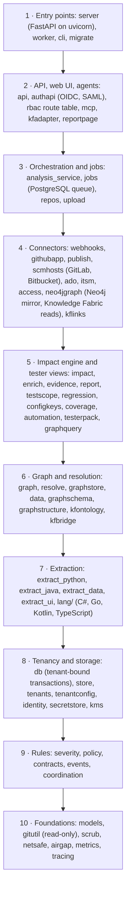

# TIA (Test Impact Analysis) Documentation

Every document about TIA as it is implemented: what it must do (PRD), how it is built, how to run and use it, and how its knowledge is represented.

---

## 📂 Documentation Files

One set of documents, describing TIA **as it is implemented**. Documents marked *generated* are produced from the code by `tools/gen_*.py`
and checked by the test suite, so they cannot drift. Superseded documents (the design-before-build architecture and framework v1.3, the
bridge plan, meeting transcripts, the case study, PDF copies and older HTML walkthroughs) were moved to `archive/docs-2026-11-23/` on
23 Nov 2026.

**Start here**

| Document | Format | Description |
| :--- | :--- | :--- |
| [**How TIA works, step by step**](../tutorial/index.html) · [full guide (book)](../tutorial/book.html) ([Markdown](../tutorial/TIA-TUTORIAL.md)) | HTML & Markdown (generated, examples from a real run) | The twelve-step pipeline, then the book following one running example. Rebuild with `python tools/gen_tutorial.py`. |
| [User guide](USER-GUIDE.md) · [Administrator guide](ADMIN-GUIDE.md) | Markdown | Using every part of the web page, reports and tester views; installing, configuring and operating TIA. |

**What TIA must do, and how it is built**

| Document | Format | Description |
| :--- | :--- | :--- |
| [**PRD (Product Requirements Document)**](PRD.md) | Markdown | Scope, user journeys, releases and acceptance criteria (v3.2). |
| [**Technical framework (as implemented)**](TECHNICAL-FRAMEWORK.md) | Markdown | v2.0: the data model, evidence statuses, inference, severity and resolution rules, result contract, persistence, security and testing as built; differences from the pre-build v1.3 and what is not built. |
| [**Architecture as built**](ARCHITECTURE-AS-BUILT.md) ([HTML](ARCHITECTURE-AS-BUILT.html)) | Markdown & HTML (generated) | Every module in its layer, the layer rule, flows, database tables and tenant isolation, deployment. |
| [**Graph schema**](GRAPH-SCHEMA.md) | Markdown (generated) | Every node and relationship type, what each connects, which carry impact, how each use case walks the graph. |
| [API reference](API.md) · [OpenAPI](openapi.json) · [Python client](../../../development/sdk/python/tia_client/__init__.py) | Markdown, JSON (generated) | Every route with its permission. |
| [Language adapter SDK](ADAPTER-SDK.md) · [Graph store decision](GRAPH-STORE.md) | Markdown | Adding languages; why PostgreSQL holds the graph. |

**Knowledge Fabric**

| Document | Format | Description |
| :--- | :--- | :--- |
| [**Knowledge Fabric bridge**](KF-BRIDGE.md) · [ontologies](kf/) | Markdown, YAML (generated) | TIA's software graph linked to Knowledge Fabric 2.5's business graph (services, test cases, screens, data, rules, user stories), kept up to date, with the business impact of every change. Tested against a simulated Knowledge Fabric graph. |
| [Neo4j mirror](NEO4J.md) · [Knowledge Fabric adapter](KF-ADAPTER.md) | Markdown | TIA's graph in Knowledge Fabric's Neo4j, registry and test-case links; reports in Knowledge Fabric's QueryResponse shape. |

**Running, securing and assessing it**

| Document | Format | Description |
| :--- | :--- | :--- |
| [Security](SECURITY.md) · [Compliance mapping](COMPLIANCE.md) · [Operations: HA, backup, DR](OPERATIONS.md) | Markdown | Threat model and review; SOC 2 / ISO 27001 controls; RPO/RTO runbook. |
| [Performance](PERFORMANCE.md) · [Release gates](RELEASE-GATES.md) | Markdown | Benchmark results; what is met, simulated or open per release. |

**Demonstrating it**

| Document | Format | Description |
| :--- | :--- | :--- |
| [Client demo script](DEMO-SPEECH.html) | HTML | A 40-minute client demo on the Northwind Pay showcase: what to click, what appears, what to say. |
| [**Client showcase**](SHOWCASE.md) | Markdown (generated) | The Northwind Pay landscape: six scenarios, evidence for every section, the exact result to expect. The repositories ship in `production/Sample test repos/`. |
| [Technical demo walkthrough](DEMO-WALKTHROUGH.md) ([HTML](DEMO-WALKTHROUGH.html)) · [Demo data](DEMO-DATA.md) | Markdown & HTML (HTML generated) | A 100-minute end-to-end technical demo; the exact inputs and numbers to expect. |

**Planned (not built)**

| Document | Format | Description |
| :--- | :--- | :--- |
| [Knowledge Fabric section in the web UI](../../../development/docs/plans/KF-UI-PLAN.md) | Markdown | Status, guided setup, links, gaps with one-click fixes, review, ontology, graph overlay; API additions, phases and tests. |

> **Tip:** double-click any `.html` file in Windows Explorer, or open it in any browser. The as-built architecture and the demo walkthrough work offline.

---

## 🏛️ High-Level System Architecture

The full picture, with every module, is [ARCHITECTURE-AS-BUILT](ARCHITECTURE-AS-BUILT.html). In short: ten layers, and a module may use only its own layer or the ones below it.

---

## ⚡ How It Works: End-to-End Pipeline

1. **Request:** a person (web UI or REST), a pull-request webhook (`webhooks.py`, `githubapp.py`, `scmhosts.py`, `ado.py`) or the CLI (`cli.py`) asks for an analysis. `authapi.py` checks the caller against the `rbac.py` route table (an unlisted route is refused) and binds the work to one tenant; webhooks are queued (`jobs.py`) and run by `worker.py`.
2. **Resolve:** `analysis_service.py` turns branch names into exact commits (`gitutil.py`, read-only git) and caps the limits with the tenant's configuration (`tenantconfig.py`).
3. **Extraction:** `extraction.py` parses only files whose git blob it has not seen: `extract_python.py` (`ast`), `extract_java.py` and `lang/` (tree-sitter), `extract_data.py` and `extract_orm.py` (tables and migrations), `extract_ui.py` (pages and elements). Code is read as bytes; it is never imported or run.
4. **Graph:** `graph.py` and `resolve.py` connect the facts across repositories into one typed graph; every edge carries how it was resolved and its evidence. `graphstore.py` records the version.
5. **Impact:** `impact.py` diffs contracts, data and functions, walks the graph within explicit bounds, adds ingested CI, coverage, deployment and runtime evidence (`enrich.py`), and scores each finding with the fixed rule table in `severity.py` (no AI). `policy.py` evaluates release rules.
6. **Report:** `report.py` renders it with the tester views (`testscope.py`, `coverage.py`, `automation.py`, `testerpack.py`); `store.py` saves it with an evidence snapshot id and an audit hash-chain entry; `publish.py` updates the PR comment and check run. The same inputs always give the same report (`POST .../reproduce` proves it).
